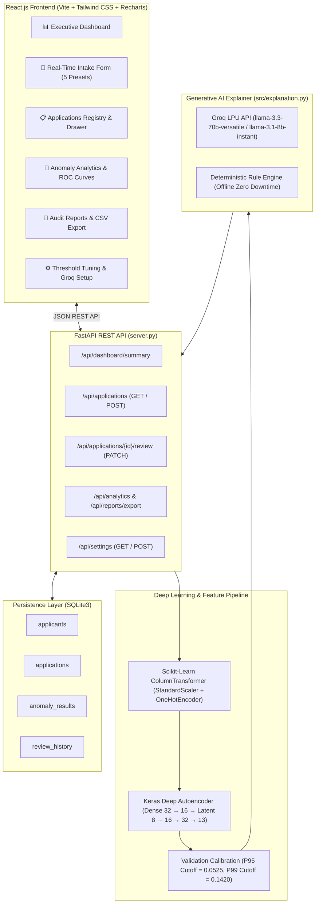

# 🛡️ RentGuard AI
### Intelligent Rental Application Anomaly Detection & Underwriting Intelligence Platform

[](https://www.python.org/)
[](https://react.dev/)
[](https://fastapi.tiangolo.com/)
[](https://keras.io/)
[](https://groq.com/)
[](https://tailwindcss.com/)
[](https://www.sqlite.org/)

---

## 📑 Table of Contents
1. [Project Overview & Philosophy](#1-project-overview--philosophy)
2. [Core Architecture & Tech Stack](#2-core-architecture--tech-stack)
3. [Key Features & Capabilities](#3-key-features--capabilities)
4. [Dataset & Injected Anomaly Typologies](#4-dataset--injected-anomaly-typologies)
5. [Deep Learning Autoencoder & Math](#5-deep-learning-autoencoder--math)
6. [Offline Model Benchmark Results](#6-offline-model-benchmark-results)
7. [Generative AI & Fallback Architecture](#7-generative-ai--fallback-architecture)
8. [REST API Documentation](#8-rest-api-documentation)
9. [Project Directory Structure](#9-project-directory-structure)
10. [Step-by-Step Setup & Installation](#10-step-by-step-setup--installation)
11. [How to Run the Application](#11-how-to-run-the-application)
12. [Comprehensive Testing & Verification Guide](#12-comprehensive-testing--verification-guide)
13. [Responsible AI & Fair Housing Compliance](#13-responsible-ai--fair-housing-compliance)
14. [Troubleshooting & FAQ](#14-troubleshooting--faq)

---

## 1. Project Overview & Philosophy

**RentGuard AI** is a commercial-grade, artificial intelligence-powered rental application anomaly detection and underwriting platform engineered specifically for property management firms, residential REITs, and independent leasing teams.

Residential underwriting processes are increasingly targeted by sophisticated inconsistencies: synthesized paystubs, inflated income-to-rent claims, fabricated employment tenures, and uncorroborated housing histories. Traditional rules engines rely on brittle, hardcoded cutoffs (e.g., $DTI > 40\%$) that fail to model non-linear relationships across multivariate features.

RentGuard AI addresses this with an **unsupervised Deep Learning Autoencoder** (TensorFlow/Keras):
1. **Learns the Latent Distribution of Legitimate Tenancies**: The model is trained exclusively on representative normal rental applications. It compresses multivariate applicant parameters into a low-dimensional bottleneck space and reconstructs them.
2. **Surfaces Outliers via Reconstruction Residuals**: Legitimate profiles compress and reconstruct cleanly with low error ($MSE$). Unusual or contradictory applications exhibit high reconstruction strain.
3. **Decomposes Feature-Level Error**: Calculates exact percentage contributions per feature, pinpointing which specific dimensions triggered the anomaly flag.
4. **Translates Findings with Generative AI (Groq LPUs)**: Translates numerical mathematical residuals into plain-language underwriting checklists and verification steps powered by Groq's high-speed `llama-3.3-70b-versatile` (with zero-downtime deterministic fallback).

### ⚖️ The RentGuard AI Ethical Mandate
* **NEVER Declares an Applicant Fraudulent**: Statistical anomalies measure deviation from a historical distribution, never fraud or guilt.
* **NEVER Automates Adverse Decisions**: The platform strictly prioritizes applications for human-in-the-loop manual review.
* **Excludes Protected Characteristics**: The neural network evaluates objective financial and tenancy parameters only (no demographic, racial, religious, familial, or disability proxies).

---

## 2. Core Architecture & Tech Stack



### Technology Matrix
| Layer | Technologies Used | Description |
| :--- | :--- | :--- |
| **Frontend** | React 18, Vite 5, Tailwind CSS 3.4, Recharts, Lucide React | High-performance dark navy real estate SaaS interface |
| **Backend API** | FastAPI 0.165, Uvicorn, Pydantic 2.14 | Asynchronous RESTful API with validation and static serving |
| **Deep Learning** | TensorFlow / Keras 3.15, NumPy, Scikit-learn, Joblib | Deep autoencoder bottleneck neural network and preprocessing |
| **GenAI Engine** | Groq API SDK, Llama-3.3-70B, Llama-3.1-8B, OpenAI SDK | Sub-second plain-language underwriter verification checklists |
| **Database** | SQLite3 with Python standard library | 4 relational tables, atomic transactions, and audit logging |
| **Data & Viz** | Pandas, Plotly Express & Graph Objects, Recharts | Data manipulation, statistical summaries, and interactive charts |

---

## 3. Key Features & Capabilities

### 1. Executive Underwriting Dashboard
* **Dynamic KPI Cards**: Ingested applications, normal baseline adherence percentage, flagged anomalies count, and pending review queue.
* **Anomaly Tier Distribution Donut**: Interactive Recharts pie chart categorizing the portfolio into Low, Medium, and High anomaly tiers.
* **Underwriting Workflow Pipeline**: Bar chart showing applications segmented by reviewer workflow status (`Pending`, `Under Review`, `Verified`, `Flagged for Clarification`).
* **Live Ingestion Feed**: Recent applicant stream with color-coded risk tags, hover animations, and one-click drawer inspection.

### 2. Live Application Intake with 1-Click Presets
* **Comprehensive Financial & Tenancy Form**: Monthly income, monthly rent, credit bureau rating slider, employment classification, continuous job duration, active loan obligations, prior court evictions, rental history duration, and residential turnover count.
* **5 Quick-Load Demonstration Presets**:
  1. `🟢 Representative Normal`: Standard balanced applicant within baseline parameters ($6,500 income, $1,750 rent, 730 credit score, 5.2 yrs tenure, 0 evictions).
  2. `🔴 Rent-to-Income Inversion`: Rent exceeds income ($1,900 income for $3,600 rent; unsustainable DTI).
  3. `🟠 Credit-Eviction Discordance`: High credit score (825) paired with multiple prior evictions (3) and heavy loan stacking (8 active loans).
  4. `🔴 Unemployed Luxury Unit`: Zero employment duration with $500 monthly income applying for a $4,200 luxury apartment.
  5. `🟠 Tenancy Mismatch`: 28 years employment with only 0.5 years independent rental history and 8 moves.
* **Instant ML Evaluation Results**:
  * Visual operational tier badge (`Low Anomaly`, `Medium Anomaly`, `High Anomaly`).
  * Quantitative reconstruction error (MSE) compared against calibrated P95/P99 cutoffs.
  * Feature reconstruction discrepancy bar chart detailing which fields contributed most to the error.
  * Generative AI verification checklist and executive property manager summary.

### 3. Registry & Slide-Over Decision Drawer
* **Searchable & Filterable Table**: Real-time text search by applicant ID or name, filter pills by anomaly tier and review decision status.
* **Underwriting Slide-Over Drawer**:
  * Complete financial profile and rent-to-income percentage badge.
  * Discrepant feature attribution progress bars.
  * Full chronological historical decision timeline.
  * Interactive review update form: Update status, assign reviewer name, submit detailed audit notes, and commit to SQLite.

### 4. Anomaly Analytics & Model Transparency
* **Reconstruction Error Distributions**: Normal baseline vs. injected outlier histogram with dashed P95 ($0.0525$) and P99 ($0.1420$) threshold lines.
* **Threshold Calibration Matrix**: Documentation of empirical percentile derivation.
* **Benchmark Performance Suite**: Precision, Recall, F1-Score, ROC-AUC, PR-AUC, and False Positive Rate metrics.
* **Interactive Confusion Matrix**: $2 \times 2$ matrix displaying True Negatives ($1,385$), False Positives ($87$), False Negatives ($0$), and True Positives ($640$).
* **Feature-Wise Discrepancy Breakdown**: Comparison of normal error vs. anomalous error across all 9 input dimensions.
* **Autoencoder Topology Viewer**: Visual representation of input, encoder, latent bottleneck, and decoder layers.

### 5. Compliance Reports & CSV Export
* **Customizable Report Scope**: Filter by anomaly category and review status.
* **Cohort Metrics Summary**: Records count, mean gross earnings, mean target rent, and average reconstruction error.
* **Direct CSV Export**: Download formatted compliance reports with one click.

### 6. System Configuration & Model Calibration
* **Interactive Threshold Sliders**: Modify medium and high anomaly cutoff boundaries.
* **Groq LPU Configuration**: Enter Groq API key (`gsk_...`), select models (`llama-3.3-70b-versatile`, `llama-3.1-8b-instant`), and test the connection live.
* **Database Reseed & Reset**: Generate fresh synthetic records and populate SQLite with a configurable sample size slider.

---

## 4. Dataset & Injected Anomaly Typologies

The synthetic dataset contains **8,000 applications** modeled to mirror residential underwriting:

### Feature Schema
| Feature | Data Type | Range / Permitted Values | Description |
| :--- | :--- | :--- | :--- |
| `applicant_id` | String | Format: `APP-XXXXX` | Unique identifier |
| `monthly_income` | Float | $1,400.00 – $28,000.00 | Gross monthly earnings |
| `monthly_rent` | Float | $650.00 – $6,500.00 | Target requested monthly lease |
| `credit_score` | Integer | 300 – 850 | Standard credit bureau score |
| `employment_duration` | Float | 0.0 – 35.0 (years) | Continuous tenure at current primary job |
| `previous_evictions` | Integer | 0 – 5 | Count of court-ordered tenancy evictions |
| `existing_loans` | Integer | 0 – 14 | Active installment or revolving debt obligations |
| `employment_status` | Categorical | Full-time, Self-employed, Part-time, Retired, Unemployed | Employment classification |
| `rental_history_duration`| Float | 0.2 – 35.0 (years) | Verifiable duration of independent leasing |
| `previous_residences` | Integer | 1 – 10 | Count of residential addresses in history |
| `is_anomaly` *(Benchmark)* | Integer | 0 (Normal) or 1 (Anomalous) | Ground-truth label strictly for offline evaluation |
| `anomaly_type` *(Benchmark)* | String | Outlier category string | Injected anomaly typology |

### Controlled Outlier Typologies (~8% of dataset)
1. **Income-Rent Inversion**: Unreasonable rent-to-income ratio (e.g., $1,800 income for a $4,200/mo unit).
2. **Credit-Eviction Discordance**: High credit score ($800+$) paired with multiple recent court evictions ($2-4$) and heavy loan burdens.
3. **Unemployed Luxury Rent**: Applicants with zero or near-zero income applying for premium properties.
4. **Employment-Tenancy Anachronisms**: Discrepancies between reported job tenure and rental duration (e.g., 28 years employment with 0.4 years rental history and 8 moves).
5. **Extreme Debt Burden**: Severe loan stacking ($8–14$ active loans) and depressed credit ratings.
6. **Fictitious Staggered Moves**: Excessive residential moves ($8–10$) compressed into a short rental window ($< 18$ months).

---

## 5. Deep Learning Autoencoder & Math

### 1. Neural Network Architecture
The model is a deep, symmetric bottleneck autoencoder built in TensorFlow/Keras:

```text
Input Layer (13 Dimensions: 8 Scaled Continuous + 5 One-Hot Categorical)
   │
   ▼
Encoder Dense 1: 32 Neurons [ReLU] + BatchNormalization + L2 Regularization (1e-4)
   │
   ▼
Encoder Dense 2: 16 Neurons [ReLU]
   │
   ▼
Latent Bottleneck: 8 Neurons [ReLU]   <-- 38% compression of input space
   │
   ▼
Decoder Dense 1: 16 Neurons [ReLU] + BatchNormalization
   │
   ▼
Decoder Dense 2: 32 Neurons [ReLU]
   │
   ▼
Output Layer: 13 Neurons [Linear Reconstructed Output]
```

### 2. Loss Function & Reconstruction Error
The network is trained to minimize Mean Squared Error (MSE) between the scaled input vector $x$ and the reconstructed output $\hat{x}$:

$$\mathcal{L}(x, \hat{x}) = \frac{1}{D} \sum_{j=1}^D (x_j - \hat{x}_j)^2$$

Where:
* $D = 13$ (transformed feature dimensions).
* $x_j$ is the $j$-th normalized input feature.
* $\hat{x}_j$ is the reconstructed feature produced by the decoder.

### 3. Feature-Wise Error Attribution
To identify which specific fields triggered an anomaly, RentGuard AI computes the residual for each individual feature dimension:
* For numerical features: $\text{Error}_f = (x_f - \hat{x}_f)^2$
* For the categorical feature (`employment_status`):
  $$\text{Error}_{\text{cat}} = \sum_{k \in \text{one-hot}} (x_k - \hat{x}_k)^2$$
* Percentage contribution per feature:
  $$\text{Contribution}_f = \frac{\text{Error}_f}{\sum_m \text{Error}_m} \times 100\%$$

### 4. Threshold Calibration Protocol
Thresholds are derived from empirical percentiles of pure normal validation applications ($N = 1,178$):
* **Medium Anomaly Threshold ($P_{95}$)**: $\text{Error} > 0.0525$
* **High Anomaly Threshold ($P_{99}$)**: $\text{Error} > 0.1420$

---

## 6. Offline Model Benchmark Results

Evaluated on held-out test data ($N = 2,112$ records: $1,472$ normal + $640$ injected anomalies):

| Evaluation Metric | Score | Underwriting Significance |
| :--- | :--- | :--- |
| **ROC-AUC** | **0.9997** | Near-flawless discrimination between normal baseline and outlier clusters |
| **PR-AUC** | **0.9992** | High precision retention across all recall cutoffs |
| **Recall** | **1.0000** | 100% of injected anomalies captured by the calibrated threshold |
| **Precision** | **0.8803** | 88.0% of flagged applications are ground-truth outliers |
| **F1-Score** | **0.9364** | Optimal harmonic mean between precision and recall |
| **False Positive Rate** | **0.0591** | Aligns with the theoretical 5.0% $P_{95}$ cutoff boundary |

### Confusion Matrix
```text
┌─────────────────────────┬──────────────────────┬──────────────────────┐
│                         │ Predicted Normal     │ Predicted Anomaly    │
├─────────────────────────┼──────────────────────┼──────────────────────┤
│ Actual Normal           │ 1,385 (TN)           │ 87 (FP)              │
│ Actual Anomaly          │ 0 (FN)               │ 640 (TP)             │
└─────────────────────────┴──────────────────────┴──────────────────────┘
```

---

## 7. Generative AI & Fallback Architecture

RentGuard AI translates numerical reconstruction residuals into actionable underwriter guidance using **Groq LPUs**:

```text
Sanitized Applicant Metrics (Income, Rent, DTI, Credit, Job Duration, Residuals)
                                    │
                                    ▼
Groq LPU Inference (Llama-3.3-70B / Llama-3.1-8B) with Strict Non-Accusatory Guardrails
                                    │
               ┌────────────────────┴────────────────────┐
               ▼                                         ▼
      [Success: ~350ms]                         [Failure / No API Key]
   Structured JSON Guidance                  Deterministic Rule Engine Fallback
   - Pattern Analysis                        - Rule-based Heuristics
   - Fields to Verify                        - Document Checklist
   - Underwriter Action Checklist            - Executive Summary
   - Executive Summary                       (Guaranteed Zero Downtime)
```

### Example Groq Verification Output
```json
{
  "explanation": "The requested monthly rent ($3,600.00) accounts for 189.5% of stated monthly income ($1,900.00), which substantially deviates from standard affordability benchmarks (typically ≤ 30-35%).",
  "fields_to_verify": ["monthly_income", "monthly_rent"],
  "suggested_steps": [
    "Request the last 3 consecutive months of bank statements or official W-2 tax forms.",
    "Verify if a co-signer, housing voucher, or guarantor is backing the lease."
  ],
  "manager_summary": "High anomaly review recommended. Primary statistical variances identified across monthly_income, monthly_rent. Follow the verification steps below before making a leasing determination."
}
```

---

## 8. REST API Documentation

The FastAPI backend (`server.py`) exposes the following REST endpoints:

| Method | Endpoint | Description | Sample Query / Payload |
| :--- | :--- | :--- | :--- |
| `GET` | `/api/health` | Health check & model status | Returns loaded artifact status |
| `GET` | `/api/dashboard/summary` | Top-level KPI counts & distributions | Returns total, normal, flagged, pending counts |
| `GET` | `/api/applications` | Searchable & filterable applications list | `?category=High%20anomaly&status=Pending&search=Marcus` |
| `GET` | `/api/applications/{id}` | Detailed application profile & audit history | `GET /api/applications/1` |
| `POST` | `/api/applications` | Ingest, score, and persist new application | JSON payload with 11 applicant fields |
| `PATCH` | `/api/applications/{id}/review` | Append underwriter review decision & notes | `{"status": "Verified", "reviewer_name": "Jane", "notes": "Approved"}` |
| `GET` | `/api/analytics` | Calibration data, distributions & metrics | Returns ROC/PR, confusion matrix, and feature comparison |
| `GET` | `/api/reports/export` | Download audit report as CSV file | `?category=All&status=Verified` |
| `GET` | `/api/settings` | Current thresholds and Groq configuration | Returns active cutoffs and model settings |
| `POST` | `/api/settings/thresholds` | Save updated P95 & P99 cutoffs | `{"medium_threshold": 0.0525, "high_threshold": 0.1420}` |
| `POST` | `/api/settings/test-llm` | Test Groq / OpenAI connection | `{"groq_api_key": "gsk_...", "groq_model": "llama-3.3-70b-versatile"}` |
| `POST` | `/api/settings/reseed` | Reseed SQLite database with synthetic apps | `{"sample_count": 150}` |

---

## 9. Project Directory Structure

```text
RentGuard-AI/
├── frontend/                         # React.js Frontend (Vite + Tailwind CSS)
│   ├── src/
│   │   ├── components/
│   │   │   ├── Sidebar.jsx           # Modern persistent navigation bar & status indicators
│   │   │   ├── Header.jsx            # Top bar with live search, refresh & reviewer profile
│   │   │   ├── Dashboard.jsx         # Executive KPI cards, Donut chart, Pipeline bar chart
│   │   │   ├── SubmitApplication.jsx # Intake form, 1-click test presets, live ML scoring & AI checklist
│   │   │   ├── AllApplications.jsx   # Searchable registry, filter pills, slide-over drawer inspector
│   │   │   ├── AnomalyAnalytics.jsx  # Error distribution, ROC/PR benchmarks, confusion matrix
│   │   │   ├── Reports.jsx           # Filterable compliance audit reports with CSV download
│   │   │   └── Settings.jsx          # P95/P99 threshold sliders, Groq API key setup, DB reset
│   │   ├── App.jsx                   # Main layout and tab orchestrator
│   │   ├── main.jsx                  # React DOM entry point
│   │   └── index.css                 # Tailwind directives, custom glassmorphism styles
│   ├── dist/                         # Production-optimized React bundle (pre-built)
│   ├── package.json
│   ├── vite.config.js
│   ├── tailwind.config.js
│   └── postcss.config.js
├── dataset/
│   ├── rental_applications.csv       # 8,000 synthetic applications (normal + outliers)
│   └── README.md                     # Dataset schema, assumptions & limitations
├── models/
│   ├── autoencoder.keras             # Trained Keras neural network weights
│   ├── preprocessor.joblib           # Fitted ColumnTransformer pipeline
│   ├── thresholds.json               # Calibrated P95 & P99 cutoffs
│   └── evaluation_metrics.json       # Benchmark metrics (ROC-AUC, PR-AUC, Confusion Matrix)
├── notebooks/
│   └── model_training.ipynb          # End-to-end interactive training & EDA notebook
├── src/
│   ├── __init__.py
│   ├── data_generator.py             # Synthetic dataset generator
│   ├── preprocessing.py              # ColumnTransformer with feature index tracking
│   ├── train_model.py                # Training & threshold calibration
│   ├── anomaly_detection.py          # Reconstruction inference, feature decomposition & evaluation
│   ├── database.py                   # SQLite schema, atomic transactions, and audit history
│   └── explanation.py                # Groq API & deterministic fallback explanation engine
├── tests/
│   └── test_system.py                # 5 comprehensive automated unit & integration tests
├── server.py                         # FastAPI backend REST API (serves API & React frontend)
├── requirements.txt                  # Python dependencies
├── .env.example                      # Environment variables template
├── .env                              # Active environment configuration (GROQ_API_KEY)
├── .gitignore
└── README.md                         # Documentation & Quickstart
```

---

## 10. Step-by-Step Setup & Installation

### Prerequisites
* **Python 3.10+** (Tested on Python 3.11.0)
* **Node.js 18+** and **npm** (Tested on Node v24.11.1 / npm 11.6.2)
* **Git**

### Step 1: Clone or Navigate to the Workspace
```powershell
cd "c:\Users\Abhinav Kumar\Desktop\College\Gen AI Project"
```

### Step 2: Set Up Python Virtual Environment
```powershell
# Create virtual environment
python -m venv venv

# Activate virtual environment (Windows PowerShell)
.\venv\Scripts\Activate.ps1

# (If using Windows Command Prompt: .\venv\Scripts\activate.bat)
# (If using Linux/macOS: source venv/bin/activate)
```

### Step 3: Install Python Dependencies
```powershell
pip install -r requirements.txt
```

### Step 4: Configure Groq API Key (Optional)
Open [.env](file:///c:/Users/Abhinav%20Kumar/Desktop/College/Gen%20AI%20Project/.env) in your text editor and paste your Groq API key:
```ini
GROQ_API_KEY=gsk_your_groq_api_key_here
GROQ_MODEL=llama-3.3-70b-versatile
```
*(Get a free Groq API key at [console.groq.com/keys](https://console.groq.com/keys). If omitted, the deterministic fallback engine activates automatically).*

### Step 5: (Optional) Install Frontend Dependencies & Build Bundle
*(The production React bundle is already pre-built inside `frontend/dist/`. If you wish to rebuild it from source:)*
```powershell
cd frontend
npm install
npm run build
cd ..
```

---

## 11. How to Run the Application

### Option A: Unified Full-Stack Run (Recommended)
This runs the FastAPI backend on port 8000, serving the REST API and the React frontend bundle from a single process:

```powershell
.\venv\Scripts\python.exe -m uvicorn server:app --host 127.0.0.1 --port 8000
```

Open your browser at: **[http://localhost:8000](http://localhost:8000)**

---

### Option B: React Vite Development Mode (Hot-Reloading)
If you wish to edit React JSX/CSS files live:

1. **Terminal 1 (Backend API):**
   ```powershell
   .\venv\Scripts\python.exe -m uvicorn server:app --host 127.0.0.1 --port 8000 --reload
   ```

2. **Terminal 2 (React Vite Dev Server):**
   ```powershell
   cd frontend
   npm run dev
   ```
   Open your browser at: **[http://localhost:5173](http://localhost:5173)** *(API calls are automatically proxied to port 8000)*.

---

## 12. Comprehensive Testing & Verification Guide

### 1. Automated Test Suite
RentGuard AI includes an automated unit and integration test suite covering dataset generation, preprocessing, autoencoder inference, database persistence, review updating, and GenAI fallbacks:

```powershell
.\venv\Scripts\python.exe -m unittest tests/test_system.py
```

**Expected Output:**
```text
.....
----------------------------------------------------------------------
Ran 5 tests in 7.708s

OK
[Database] SQLite schema verified and ready at data/test_rentguard.db
[Dataset Generator] Successfully generated 200 records (180 normal, 20 anomalies).
[Dataset Generator] Saved to dataset/test_dataset.csv
```

### 2. Manual Testing Walkthrough

#### Test 1: Dashboard Verification
1. Open `http://localhost:8000`.
2. Confirm the 4 KPI cards load with numbers (Total Ingested: ~150, Normal Baseline, Flagged Outliers, Pending Decisions).
3. Verify the Anomaly Distribution donut chart displays the three risk tiers (Low, Medium, High).
4. Verify the Underwriting Audit Pipeline bar chart displays status counts.

#### Test 2: Ingest a Normal Application
1. Click **Submit Application** in the sidebar.
2. Click the `🟢 Normal Baseline` preset button.
3. Click **Evaluate & Ingest Application**.
4. **Verification**:
   * Reconstruction Error should be low (typically $\le 0.0525$).
   * Operational Tier badge should be **Low Anomaly** (Green).
   * Generative AI guidance should confirm alignment with reference baseline.

#### Test 3: Ingest an Outlier Application
1. On the **Submit Application** page, click the `🔴 Rent Inversion` preset button ($1,900 income for $3,600 rent).
2. Click **Evaluate & Ingest Application**.
3. **Verification**:
   * Reconstruction Error will spike ($> 0.1420$).
   * Operational Tier badge should display **High Anomaly** (Red).
   * Feature Reconstruction Discrepancies bar chart will show `monthly_rent` and `monthly_income` as top contributing features.
   * Groq AI guidance will recommend requesting 3 months bank statements or verifying co-signers.

#### Test 4: Underwriting Decision Workflow
1. Navigate to **All Applications** in the sidebar.
2. Click on any application in the table.
3. The **Slide-over Decision Drawer** will open on the right.
4. Review the applicant's financial metrics and feature residuals.
5. In the **Append Underwriter Audit Decision** form:
   * Change status to `Verified (Approved)`.
   * Enter your name: `Senior Underwriter Jane`.
   * Add notes: `Confirmed 3 months paystubs and employer verification letter. Approved.`
   * Click **Save Underwriting Decision**.
6. **Verification**: Confirm the decision timeline updates and the table reflects the new `Verified` badge.

#### Test 5: Analytics & Reports
1. Navigate to **Anomaly Analytics**: Check the distribution histogram, confusion matrix heatmap, and feature comparison bar chart.
2. Navigate to **Reports & Export**: Select filters and click **Export Filtered Report (CSV)** to verify the download of `RentGuard_Audit_Report.csv`.

#### Test 6: Groq LLM Configuration & Retraining
1. Navigate to **Settings**:
2. Under **Groq LPU Generative AI Explainer**, enter your Groq API key and click **Test Groq Connection**. Confirm the response indicates success.
3. Adjust the **Medium Threshold (P95)** and **High Threshold (P99)** sliders and click **Save Calibrated Thresholds**.
4. Test **Populate / Reseed SQLite** with the slider set to 150 records.

---

## 13. Responsible AI & Fair Housing Compliance

RentGuard AI adheres to the following principles:

1. **Exclusion of Protected Attributes**: The feature schema deliberately excludes race, color, religion, national origin, sex, disability, familial status, age, and marital status.
2. **Transparent Mathematical Residuals**: Every flagged application includes feature-wise error decompositions showing underwriters exactly which financial dimensions deviated.
3. **Non-Accusatory Tone**: All AI-generated explanations are framed as neutral statistical anomalies requiring routine documentation verification, never accusations of fraud or dishonesty.
4. **Human-in-the-Loop Requirement**: The platform is strictly an underwriting copilot. Rejections and approvals are executed solely by licensed human leasing professionals.

---

## 14. Troubleshooting & FAQ

#### Q1: What if I don't have a Groq API key?
RentGuard AI has a built-in deterministic rule engine that runs locally with zero downtime. If no Groq key is provided, the application automatically uses this engine to generate verification checklists.

#### Q2: What if port 8000 is already in use?
Run uvicorn on an alternate port:
```powershell
.\venv\Scripts\python.exe -m uvicorn server:app --host 127.0.0.1 --port 8080
```

#### Q3: How do I retrain the Deep Learning Autoencoder?
To retrain the neural network on a fresh synthetic dataset:
```powershell
.\venv\Scripts\python.exe -m src.train_model
```
This updates `models/autoencoder.keras`, `models/preprocessor.joblib`, `models/thresholds.json`, and `models/evaluation_metrics.json`.

---

<p align="center">
  <strong>RentGuard AI &copy; 2026</strong> &bull; Enterprise Rental Underwriting & Anomaly Detection System.
</p>
